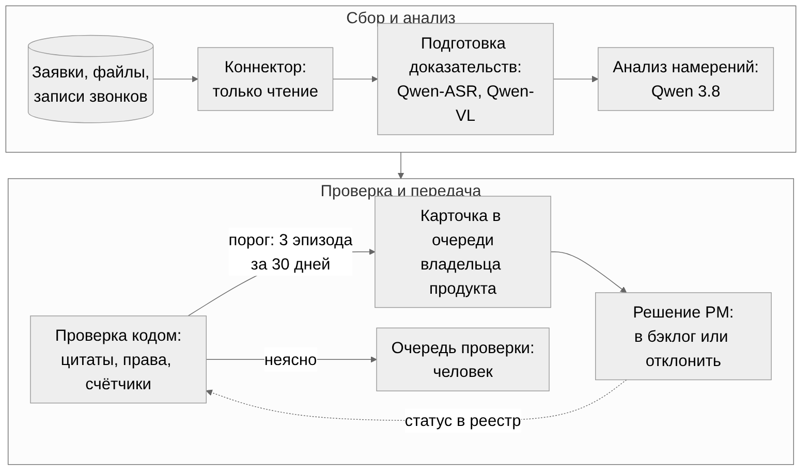

# ИИ-агент для передачи пожеланий в продуктовые команды

Решение кейса Intelligence Cup 2026 («Газпром нефть»). Агент читает все обращения в поддержку — заявки из единого окна и записи звонков, — находит повторяющиеся пожелания и раз в день кладёт владельцу продукта карточку с цитатами и числом независимых случаев. Поддержка не делает ничего нового; решение о доработке принимает человек. Модель Qwen 3.8 понимает текст, код проверяет цитаты, права и счётчики.



| Что сдаём | Файл |
|---|---|
| Основное решение: архитектура, инструменты, промпт, тестирование и приёмка, финансовая модель (вопросы 1-4, 6) | [submission/solution.pdf](submission/solution.pdf), [solution.docx](submission/solution.docx) |
| Эффект внедрения и метрики (вопрос 5) | [submission/metrics.md](submission/metrics.md) |
| Презентация, 10 слайдов | [submission/presentation.pptx](submission/presentation.pptx) |
| AI Footnotes (опционально) | [submission/ai-footnotes.docx](submission/ai-footnotes.docx) |

| Три числа решения | Откуда |
|---|---|
| 1 000 обращений в день, 1 200-2 000 вызовов Qwen, 25 аудиочасов — обрабатывают три приложения и пять сервисов | Расчёт нагрузки, раздел 1 |
| 2 760 часов в год высвобождает поддержка с учётом новой работы PM и QA | Раздел 6, допущения проверяются в пилоте |
| 2,986 млн ₽ — потолок дисконтированных вложений, при котором проект окупается за 3 года в базовом сценарии | Раздел 6, `tools/finance_model.py` |

Все цифры с происхождением (условие, допущение, эксперимент, источник) собраны в [docs/assumptions.md](docs/assumptions.md).

## Что уже проверено

| Что | Где | Что это доказывает, а что нет |
|---|---|---|
| Прототип извлечения намерений на открытой Qwen3-4B и Qwen3-8B, 23 и 48 примеров, 19 записанных прогонов | [experiments/holdout_v2](experiments/holdout_v2/README.md), [experiments/live_qwen](experiments/live_qwen/README.md) | Формат ответа держится (47 из 48 на 4B, 48 из 48 на 8B после двух повторов); главная открытая ошибка — склейка близких тем. Качество внутренней модели на данных компании проверяется в пилоте |
| Протокол сравнения, зафиксированный до запуска: хеши кода и данных, объявленные критерии | [experiments/holdout_v2/protocol.json](experiments/holdout_v2/protocol.json) | Результаты нельзя подогнать задним числом |
| Калькуляторы финмодели и Coverage7 с тестами | [tools/finance_model.py](tools/finance_model.py), [tools/coverage_model.py](tools/coverage_model.py) | Любой сценарий пересчитывается своей цифрой |
| Демонстратор правил: порог, права, идемпотентность, удаление, старение окна | [demo](docs/technical-demo.md) | Логика кода проверена тестами; это не оценка модели |
| Офлайн-аудит комплекта и CI | [.github/workflows/check.yml](.github/workflows/check.yml) | Лимит 15 000 символов, совпадение копий, хеши файлов |

## Повторить проверку за две минуты

Нужен Python 3.10+. Пакеты, интернет и ключи моделей не требуются.

```bash
python3 scripts/verify_delivery.py --output artifacts/audit.json   # полный офлайн-аудит
python3 tools/finance_model.py --case base                          # пересчёт базового сценария
python3 scripts/build_submission.py --check                         # манифест соответствует файлам
```

Пересобрать комплект из исходников: `pip install python-docx python-pptx`, затем `python3 scripts/build_submission.py` (PDF требует LibreOffice). Запуск локальной Qwen описан в [docs/live-experiment.md](docs/live-experiment.md).

## Что неизвестно и как узнаем

| Неизвестно | Как узнаем |
|---|---|
| Сколько часов менеджеры тратят на анализ обращений сейчас | Хронометраж 2-4 недели до запуска пилота |
| Скорость и лимиты внутренних Qwen 3.8, Qwen-ASR, Qwen-VL | Бенчмарк на внутреннем контуре, первые недели пилота |
| Точность и полнота на данных компании | Разметка 600 обращений двумя экспертами и арбитром, критерии релиза в разделе 4 |
| Денежная выгода | Реестр избежанных платежей и подтверждённой маржи; до него эффект считается в часах |

## Для команды

- [CLAUDE.md](CLAUDE.md) — правила работы в репозитории, политика папок, стандарт текста.
- [EXECUTOR.md](EXECUTOR.md) — инструкция автономного исполнителя для Claude Code.
- [team/sprint-plan.md](team/sprint-plan.md) — план до 25.11, [team/tasks](team/tasks/README.md) — задания, [team/decisions.md](team/decisions.md) — журнал решений.
- [team/brief.md](team/brief.md) и [team/rehearsal.md](team/rehearsal.md) — подготовка к защите; [docs/how-to-check-our-work.md](docs/how-to-check-our-work.md) — как проверить прототип.

Первичные источники: Банк России, решение по ключевой ставке от 23.10.2026 и среднесрочный прогноз (cbr.ru, проверено 02.11.2026); OWASP LLM01 Prompt Injection (genai.owasp.org, проверено 02.11.2026).
