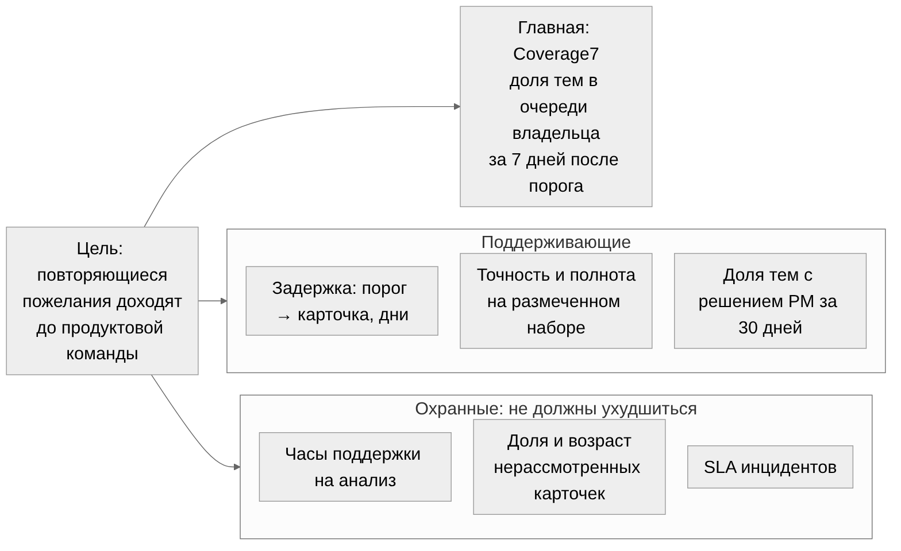

# Метрики: доходят ли повторяющиеся пожелания до продуктовой команды

Ответ на вопрос 5. Из условия известно: около 40 менеджеров сопровождения, два канала, годовой архив тикетов, вложений и звонков. Сколько сотрудников сегодня разбирают обращения и сколько тратят времени — неизвестно, это первое, что измеряем. Пороги ниже предложены для пилота и фиксируются до его старта.

## 1. О чём думаем сначала: единица успеха

Число созданных карточек успехом быть не может: оно растёт от дублей и от шума. Единица анализа — **повторяющееся явное пожелание по одному продукту, подтверждённое цитатой пользователя**, которое владелец продукта увидел вовремя.

| Решение | Правило |
|---|---|
| Что считаем повторяющимся | ≥ 3 независимых пользовательских эпизодов за скользящие 30 дней (окно (t − 30 × 24 ч, t] в UTC) и, если ID надёжны, ≥ 2 клиентов. Звонок, заявка и повторное открытие об одном случае — один эпизод; связи подтверждает система или эксперт, непроверенные связи порог не выполняют и показываются отдельно |
| Что считаем явным пожеланием | Высказывание самого пользователя (user_explicit). Реплика оператора, пересказ, гипотеза модели — не пожелание. Неясный автор → needs_review |
| Что не входит в основной KPI | Гипотезы улучшений из инцидентов и операционных просьб, массовые дубли инцидента, искусственные пожелания. Редкие важные пожелания хранятся отдельным списком |
| Область счёта | Одна область прав получателя (scope_id): порог, eligible_at, числитель и знаменатель считаются в ней. Скрытые от владельца эпизоды порог не дополняют; изменение прав отмечается в отчёте, чтобы не выглядеть ростом качества |
| Когда правило можно менять | Только до пилота. Если надёжных ID клиентов нет — заранее выбираем KPI по эпизодам и подписываем ограничение |

Два момента времени: **eligible_at** — когда впервые выполнены все условия порога (нашёл ли тему агент, неважно); **delivered_at** — подтверждённое системой появление карточки с доказательствами в защищённой очереди владельца. Уведомление без доступной карточки доставкой не считается.

## 2. Главная метрика: Coverage7

**Coverage7** = эталонные повторяющиеся потребности, доставленные владельцу не позднее 7 × 24 ч после eligible_at ÷ все эталонные повторяющиеся потребности зрелой когорты.

| Поле | Содержание |
|---|---|
| Эталон | Составляют люди, не видя выводов агента, поэтому пропущенные моделью темы остаются в знаменателе |
| Зрелая когорта | Темы с полными семью днями наблюдения после eligible_at; незавершённая неделя не записывается в пропуски. При нуле тем — N/A с указанием числа тем и периода |
| Новизна | Последние 30 дней показывают частоту, не новизну. Новизну подтверждает исторический реестр на дату оценки; темы с неизвестной историей считаются отдельной когортой «первое наблюдаемое достижение порога» и не называются новыми |
| Единица счёта | Тема учитывается один раз в когорте, по первому достижению порога; стабильный ID и экспертные решения о слиянии сохраняют единицу |
| Источник данных | Полный эталон выбранных окон «продукт × неделя» и журнал доставки (outbox) |
| Ретроспектива по архиву | Возможна для подтверждённых документами передач: ссылки на бэклог, журналы, карточки. Отсутствие ссылки — «передача не подтверждена», а не «не было». Публикуем три числа: документально подтверждённое покрытие, оценку после проверки владельцами, долю неизвестного |
| Как отслеживать дальше | Еженедельно, отдельно по продуктам и каналам; общая оценка с весами отбора окон |
| Цель и критерий | ≥ 80% и прирост относительно контроля; публикуем разницу в п.п. и 95% интервал. До старта выбираем минимальный полезный прирост, например +20 п.п. Если исходное покрытие уже ≥ 80% — цель меняется на сохранение покрытия при сокращении задержки или труда |
| Запасной вариант | Если истории доставки нет — сначала собираем исходный уровень 2-4 недели до запуска. Если нет надёжных ID клиентов — вариант по эпизодам. Если знаменатель мал — расширяем согласованное наблюдение или признаём данные недостаточными |

**Пример расчёта** (`tools/coverage_model.py --example`, синтетические данные): в когорте 4 эталонные темы, одна ещё не дозрела и исключена; из трёх зрелых одна доставлена вовремя, одна поздно, одна не доставлена → Coverage7 = 1 / 3 = 33,3%. Отдельно показываем когорту с известной историей (1 / 2 = 50%) и когорту с неизвестной историей (0 / 1); вторая включена в знаменатель и не называется новыми пожеланиями.

## 3. Поддерживающие и охранные метрики

| Метрика | Формула | Источник | Ретроспектива по архиву | Отслеживание | Цель | Запасной вариант |
|---|---|---|---|---|---|---|
| Задержка передачи | delivered_at − eligible_at: p50, p90, доля непереданных | Даты эпизодов, outbox, бэклог | Только для документально подтверждённых передач | Еженедельно | p90 ≤ 7 дней по всем зрелым темам, включая непереданные | Если p90 не определяется из-за пропусков — показываем нижнюю границу и Coverage7; задержку только по удачным передачам не считаем |
| Точность пожеланий | Верно извлечённые ÷ все предсказанные, независимый эталон | Слепая оценка экспертами всех карточек или выборки | По архиву — да, на размеченной выборке | Каждый релиз модели или промпта | Нижняя 95% граница ≥ 90% по включаемому каналу | При малом объёме — расширить выборку; канал без достаточных данных не публикуется |
| Полнота извлечения | Найденные эталонные ÷ все эталонные | Независимая выборка обращений; для тем — полный аудит окон | По архиву — да | Каждый релиз | Нижняя 95% граница ≥ 80%; текст, звонки, вложения отдельно | Результат по тексту не переносится на ASR и VL без их разметки |
| Дубликаты и ошибочные слияния | Карточки без новых доказательств ÷ все карточки; слияния разных потребностей | Бэклог, экспертная проверка | По архиву — частично | Еженедельно | ≤ 5% | Ручная проверка выборки карточек |
| Нагрузка поддержки (охранная) | Активные минуты на сбор, поиск, выгрузку и передачу пожеланий за продукт-неделю | Дневник времени до и после, события интерфейса | Нет: нужен замер 2-4 недели до запуска | Недельные итоги | Верхняя граница одностороннего 95% интервала изменения ≤ 0; новых обязательных действий нет | Если точности не хватает — отсутствие роста считается недоказанным; допуск +5% только по отдельному согласованию |
| Суммарная трудоёмкость (охранная) | Часы поддержки, PM, аналитиков, эксплуатации — по ролям | Учёт активного времени в пилоте | Нет | Ежемесячно | Работа не переложена с поддержки на PM | Если учёта нет — измеряем типовые операции и частоту, указываем диапазон |
| Решение владельца | Доля карточек с решением «принять / отклонить / нужны данные / уже в работе» за 10 рабочих дней; доля и возраст нерассмотренных | События очереди продукта | Нет | Еженедельно | Показатель использования; обоснованный отказ — нормальный результат | Считать по всем карточкам, не только по пяти из дайджеста |
| Результат доработки продукта | Повторные эпизоды на 1 000 пользователей, успех целевого сценария, маржа после конкретного улучшения | Продуктовая аналитика, даты релизов | Нет | После релиза | Эффект измеряется, а не предполагается | Без релиза метрика не заполняется |
| Надёжность и безопасность (охранная) | Доля доставок без дубля, доля карточек с проверяемыми ссылками, несанкционированные раскрытия | Outbox, аудит, тесты прав | Нет | Постоянно | 100% карточек с проверяемыми доказательствами; утечка или обход прав останавливают публикацию | — |

## 4. Что можно посчитать по архиву сейчас, а что только после пилота

| По годовому архиву сейчас | Только после пилота |
|---|---|
| Объём обращений по каналам и продуктам, сезонность, пропуски и дубли архива | Исходные часы анализа: разница между открытием и закрытием тикета трудозатрат не показывает |
| Точность и полнота извлечения на размеченной выборке (с 600 обращений) | Задержка передачи, если нет исторических версий тикетов |
| Документально подтверждённое покрытие по ссылкам в трекере и бэклоге, с долей неизвестного | Нагрузка поддержки и трудоёмкость по ролям |
| Распределение частот тем для выбора порога 3 / 30 дней | Решения владельца и результат доработок |
| Классификация на текущем тексте — ограниченная проверка | Причинный эффект и денежная выгода |

Порядок восстановления: разрешённый снимок архива с ticket ID, продуктом, датами, каналом, безопасным хешем клиента, связью звонка с тикетом, типом вложения и ссылкой на бэклог → два эталона (выборка обращений и случайные окна «продукт × неделя» с 30 днями предыстории и 7 днями наблюдения) → разметка двумя экспертами вслепую с арбитром → восстановление ручной передачи по документам → воспроизведение обработки только на данных, существовавших к дате; семейства дублей разделяются между настройкой и закрытым тестом; пороги по закрытому тесту не подбираются.

## 5. Как проверить эффект агента в пилоте

Порядок: доступы и архив → исходные замеры → обработка копии потока без публикации → ограниченная публикация → решение о расширении; ориентир 8-12 недель.

| Вариант | Когда | Что сравниваем |
|---|---|---|
| Основной: пары продуктов | Есть ≥ 2 сопоставимых команды | В каждой паре агент включается случайно одной команде; единица назначения — команда (один PM на несколько продуктов — одна единица). DiD = (после − до) агент − (после − до) контроль, 95% интервал и рандомизационная проверка |
| Запасной 1: очередь подключения | Одновременное разделение невозможно | Случайная очередность команд, сохранённые периоды без агента, одинаковая разметка, учёт календарных эффектов |
| Запасной 2: сопоставимый контроль | Случайность невозможна | Проверка предшествующих трендов; вывод о причинности ограничен |
| Запасной 3: прерванный ряд | Контроля нет | Анализ временного ряда с оговорками о релизах и сезонности |

MVP на одном продукте проверяет осуществимость и изменение процесса; контрольной группы у него нет, поэтому причинный денежный эффект остаётся гипотезой до эксперимента с независимыми командами. Назначать режим отдельным тикетам одной команды нельзя: PM перенесёт найденное в контрольную группу. Сорок менеджеров общих команд не становятся сорока наблюдениями. Отмечаем релизы, акции, инциденты, изменение клиентской базы и SLA. Выгода после доработки требует цепочки с зафиксированными событиями: сигнал найден → решение PM → релиз вышел → поведение изменилось → денежный поток подтверждён.

## 6. События и решение о внедрении

Минимальный набор событий: `ticket_ingested`, `episode_resolved`, `need_candidate`, `eligibility_reached`, `evidence_verified`, `card_published`, `owner_acknowledged`, `decision_recorded`, `release_linked`, `benefit_verified`. В событии: product_id, scope_id, версия ACL, статус истории темы, непрозрачные ID эпизода, потребности и карточки, время, версии модели, промпта и инструмента, ID источников, ключ идемпотентности, статус и класс ошибки. Персональные данные в метрики не выносятся; права и срок удаления наследуются от первоисточников, включая агрегаты, по которым можно восстановить человека. Определения и версии KPI сохраняются вместе с отчётом.

До пилота согласуем словарь метрик, правила повторов и исключений, план отбора, минимальный эффект, длительность и мощность, критерий отсутствия роста нагрузки поддержки и допустимое время PM на карточки.

| Решение | Условие |
|---|---|
| Расширить на другие продукты | Технические проверки и проверки безопасности пройдены; точность и полнота выше порогов; Coverage7 ≥ 80% с приростом к контролю (или сохранение покрытия при меньшей задержке или труде, если выбрано заранее); нагрузка поддержки не выросла; финансовый порог пересчитан по измеренным данным |
| Продолжить ограниченный пилот | Бизнес-эффект статистически неопределён; качество выше порогов |
| Остановить | Утечка или обход прав; рост нагрузки поддержки; точность ниже порога без плана исправления |
